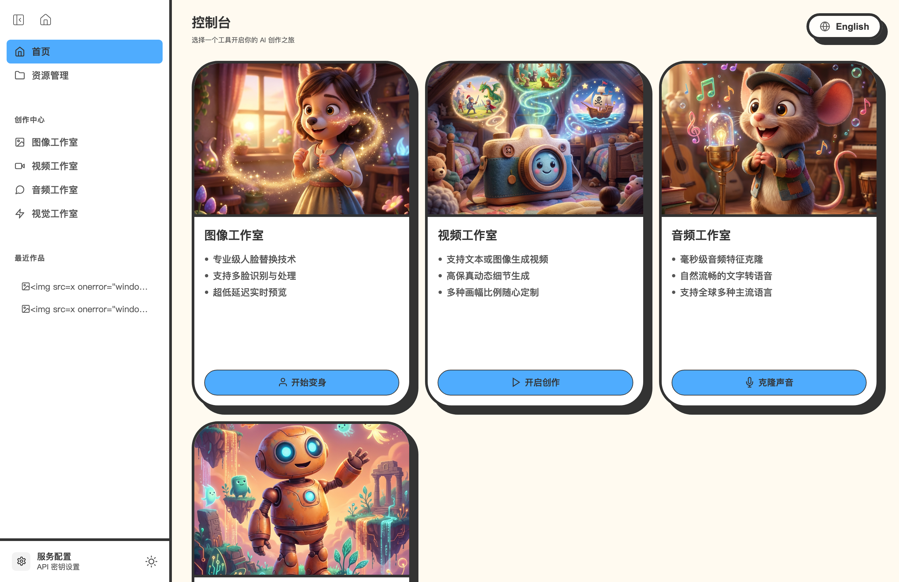
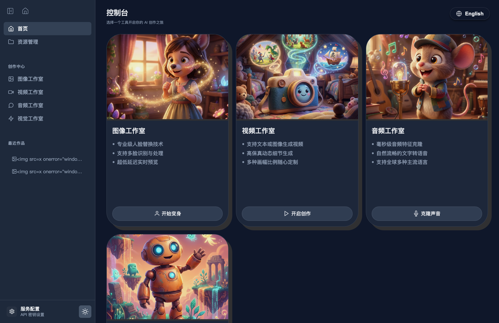
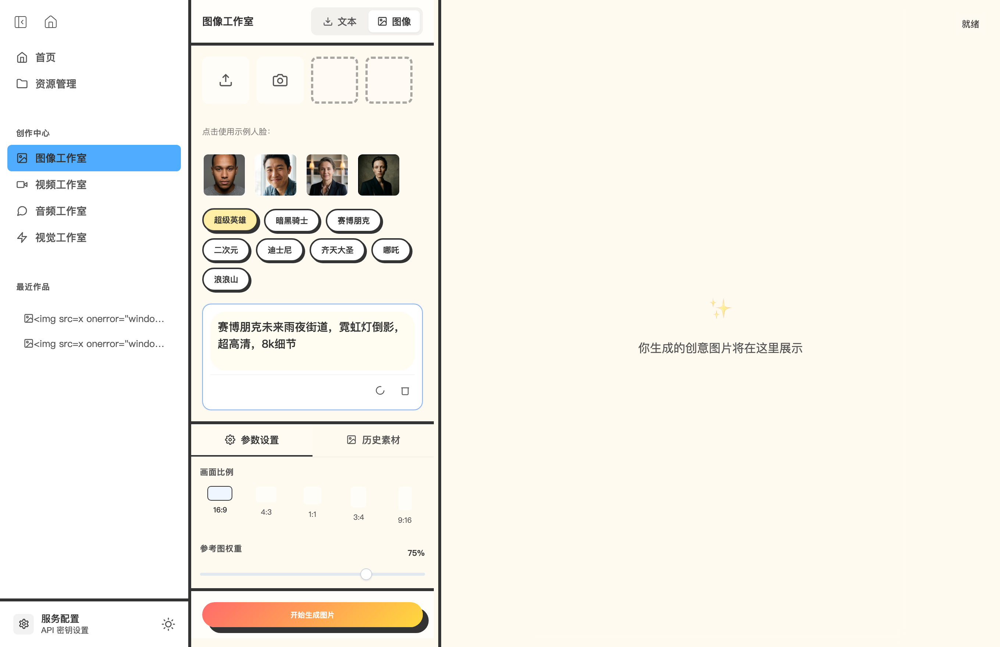
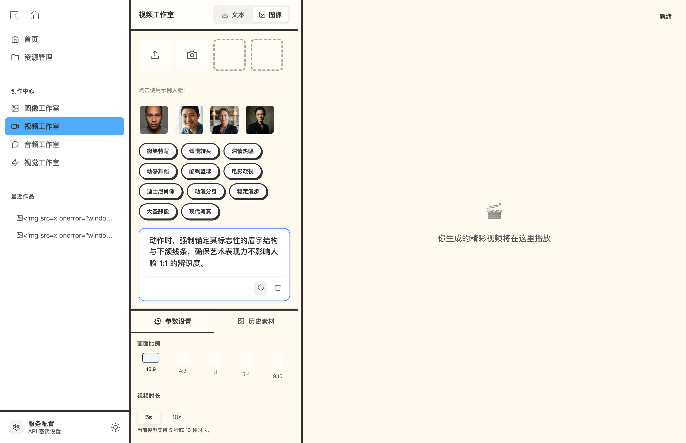
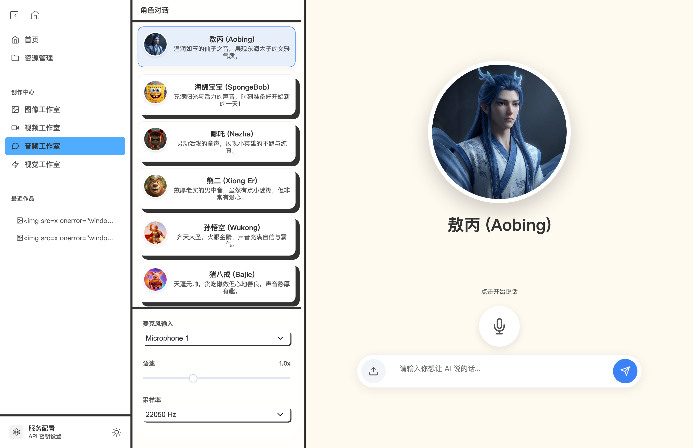
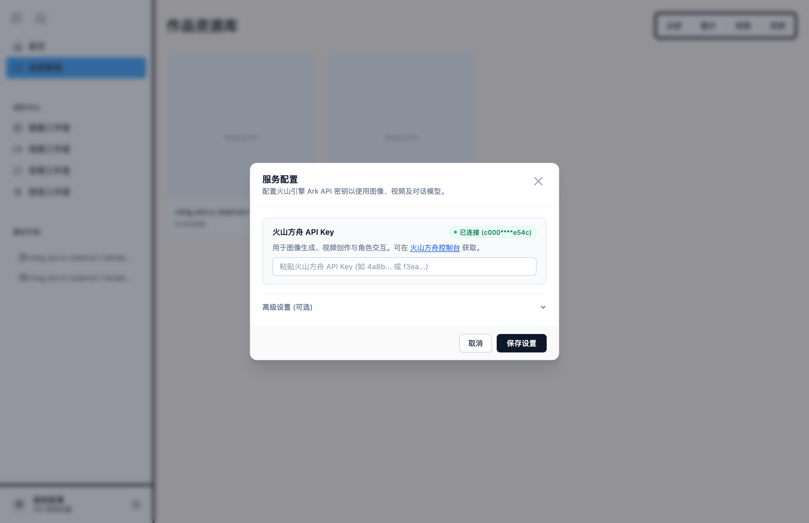
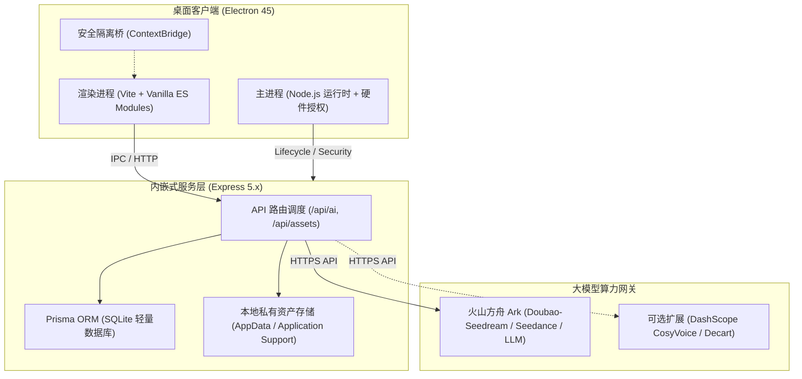

# AI 媒体工作室 (AI Media Studio)

<div align="center">

[](https://github.com/nnin-nnin/AI_Media_Studio/actions/workflows/build-desktop.yml)
[](LICENSE)
[](https://github.com/nnin-nnin/AI_Media_Studio/releases)
[](https://www.electronjs.org/)
[](CONTRIBUTING.md)

**跨平台桌面级多模态 AI 创意工坊 · 一键解锁四大创作引擎**

基于现代 Electron 与 Express 双模架构打造，集**图像创作与换脸**、**AI 视频生成**、**智能角色语音对话**与**实时视觉魔镜**于一体。仅需一个火山引擎方舟 API 密钥，即可在 Windows 与 macOS 上实现零门槛多模态创意生产。

[下载安装包](#快速下载与安装) • [安装指南](INSTALLATION.md) • [核心特性](#核心特性) • [技术架构](#技术架构) • [本地开发](#本地开发与构建) • [使用指南](#快速上手)

</div>

---

## 界面概览

### 1. 现代化极简控制台 (Dashboard)


### 2. 深色模式与四大创作模块


---

## 核心特性

- **单一密钥，全能驱动**：仅需配置一个**火山方舟 API Key**（`ARK_API_KEY`），即刻解锁生图、图生图、视频生成、角色交互对话全链路，无需繁杂的云厂商跨平台申请。
- **四大核心创作工作室**：
  1. **图像工作室（Face Swap & Image Studio）**：支持骨骼级人脸替换、写实动漫/二次元风格迁移与高精度文生图（Doubao-Seedream 4.0）。
  2. **视频工作室（Video Generation Studio）**：内置电影级运镜控制参数与一键随机灵感生成，支持 5s / 10s 高保真动态视频渲染。
  3. **音频工作室（Voice Chat Studio）**：预置敖丙、孙悟空、哪吒、海绵宝宝等高辨识度角色，支持麦克风实时人声对话与情绪语调演绎。
  4. **视觉工作室（Realtime Vision Studio）**：离线 MediaPipe 手势识别与镜头实时风格滤镜（梵高星空、赛博朋克、粘土动画等）。
- **100% 纯 JavaScript 绿色架构**：彻底剥离 Python、FFmpeg 等复杂系统依赖，全栈基于纯 Node.js，无需配置任何 Python 环境，开箱即用率 100%。
- **双模并行（桌面客户端 + 本地 WebUI）**：
  - **模式 A：独立桌面客户端（Electron）**：提供 Windows 单文件安装包/便携版与 macOS DMG 镜像，全中文界面，原生硬件权限放行，小白用户双击即用。
  - **模式 B：本地 WebUI 一键运行（ComfyUI 风格）**：双击 `start.command` (Mac) 或 `start.bat` (Windows)，后台自动拉起并秒开默认浏览器，零系统拦截。
- **本地隐私与持久化资产库**：
  - 用户生成的作品统一落盘在系统标准的个人应用目录中（`Application Support` 或 `AppData`），升级应用不会丢失作品；
  - 内置轻量 SQLite 本地数据库，支持分类筛选、全屏预览与本地一键导出。
- **Apple 风格人机交互**：
  - 彻底剔除塑料感 Emoji 堆叠与粗劣动画，采用克制优雅的无衬线排版与微拟物毛玻璃弹窗；
  - 完整的中英文双语（i18n）即时切换与深色/浅色主题适配。

---

## 快速下载与安装

前往 [GitHub Releases 页面](https://github.com/nnin-nnin/AI_Media_Studio/releases) 获取适用于您操作系统的最新安装包：

| 平台 | 安装包格式 | 说明 |
| :--- | :--- | :--- |
| **macOS (Apple Silicon)** | `.dmg` / `.zip` | 适配 M1 / M2 / M3 / M4 系列芯片 Mac |
| **macOS (Intel)** | `.dmg` / `.zip` | 适配 Intel 架构 Mac |
| **Windows 10 / 11** | `.exe` (NSIS) | 标准 Windows 安装引导向导 |
| **Windows 便携版** | `.exe` (Portable) | 免安装解压即用 |

### macOS 首次打开安全提示说明
由于未购买昂贵的苹果开发者商业签名证书，首次打开时若提示“无法验证开发者”，请右键点击应用图标并选择**「打开」**，在安全弹窗中点击**「确认打开」**即可。

---

## 快速上手

### 方式一：独立桌面客户端（推荐非技术用户）

1. **首次启动**：
   下载并双击启动 **AI 媒体工作室**。若本地未配置密钥，屏幕将自动弹出「服务配置」引导窗口。
2. **填写火山方舟密钥**：
   - 登录 [火山引擎方舟控制台](https://console.volcengine.com/ark) 复制您的 API Key；
   - 粘贴至输入框并点击「保存设置」，状态徽标变绿显示 `● 已连接`，弹窗自动关闭。
3. **开始创作**：
   - 在首页点击任一工作室卡片；
   - 点击预设风格标签（如“赛博朋克”）或“随机灵感提示词”；
   - 点击生成按钮，作品将自动保存在左侧的「资源管理」中。

### 方式二：本地 WebUI 一键运行（类似 ComfyUI 风格）

1. **下载或解压源码包**；
2. **双击本地一键启动脚本**：
   - **Windows 用户**：直接双击 `start.bat`
   - **macOS 用户**：直接双击 `start.command`
   - **Linux / 终端用户**：运行 `./start.sh`
3. 脚本会自动拉起本地服务并自动在默认浏览器中打开 `http://localhost:3000`。

### 方式三：云端与服务器一行命令安装（OpenClaw 风格）

适用于 Linux (Ubuntu / Debian / CentOS / Rocky) 或 macOS 服务器，一行命令全自动检测 Node.js 运行时、克隆代码、构建静态资产并可选配置 systemd 后台保活守护进程：

```bash
curl -fsSL https://raw.githubusercontent.com/nnin-nnin/AI_Media_Studio/main/install.sh | bash
```

Windows PowerShell 自动化安装：
```powershell
powershell -ExecutionPolicy ByPass -c "irm https://raw.githubusercontent.com/nnin-nnin/AI_Media_Studio/main/install.ps1 | iex"
```

---

## 各工作室功能截图

| 图像工作室 | 视频工作室 |
| :---: | :---: |
|  |  |

| 角色语音对话 | 服务配置向导 |
| :---: | :---: |
|  |  |

---

## 技术架构



---

## 本地开发与构建

### 1. 环境准备
- Node.js >= 20.0.0
- npm >= 10.0.0
- Git

### 2. 克隆仓库与安装依赖
```bash
git clone https://github.com/nnin-nnin/AI_Media_Studio.git
cd AI_Media_Studio
npm install
```

### 3. 初始化本地数据库
```bash
npm run db:push
npm run db:seed
```

### 4. 启动开发模式
```bash
# 启动 Web 开发双进程 (前端 Vite + 后端 Express)
npm run dev

# 或启动完整 Electron 桌面开发调试
npm run electron
```

### 5. 运行测试套件
项目配备了完整的单元测试、API 集成测试与 Playwright 端到端浏览器测试：
```bash
npm test
```

### 6. 打包分发安装包
```bash
# 编译前端并打包当前系统桌面应用
npm run electron:build

# 单独打包 macOS 安装包 (.dmg 和 .zip)
npm run build:mac

# 单独打包 Windows 安装包 (.exe)
npm run build:win
```

---

## 目录结构

```
AI_Media_Studio/
├── .github/
│   ├── ISSUE_TEMPLATE/     # 统一 Issue 模板 (Bug 报告 / 功能建议)
│   └── workflows/          # GitHub Actions 自动化多平台构建发布流
├── docs/
│   └── images/             # 项目截图与视觉资产
├── electron/
│   ├── main.js             # Electron 主进程 (生命周期、权限控制与端口管理)
│   ├── preload.cjs         # ContextBridge 安全隔离桥
│   └── preload.js
├── prisma/
│   └── schema.prisma       # SQLite 数据实体架构
├── release/                # 打包输出目录 (.dmg, .zip, .exe)
├── src/
│   ├── renderer/           # 前端应用源码 (HTML / CSS / ES Module 组件)
│   └── server/             # 后端 Express 服务 (AI 服务层、存储、路由)
├── electron-builder.json   # Electron 多平台打包配置文件
├── package.json
└── vite.config.js          # Vite 构建配置与静态资源自动化插件
```

---

## 贡献指南

欢迎任何形式的贡献！在提交 Pull Request 之前，请阅读 [CONTRIBUTING.md](CONTRIBUTING.md)。如有 Bug 报告或功能建议，欢迎提交 [GitHub Issue](https://github.com/nnin-nnin/AI_Media_Studio/issues)。

---

## 开源协议

本项目基于 [MIT License](LICENSE) 许可协议开源。
